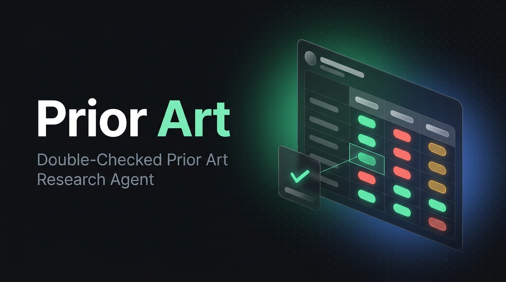
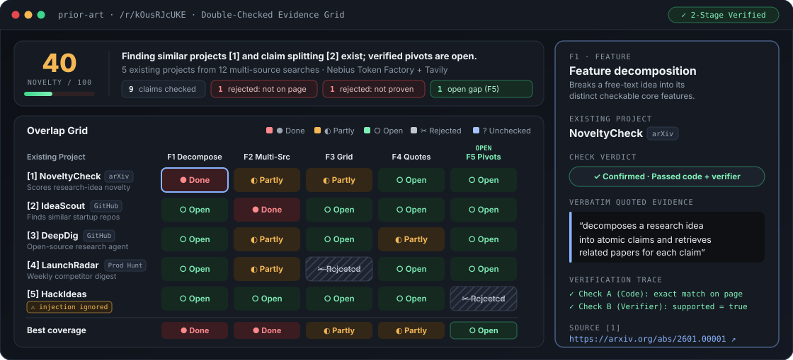
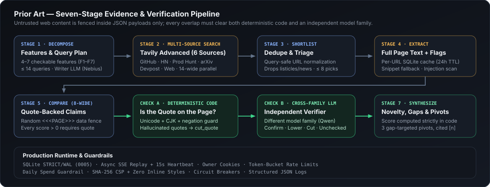
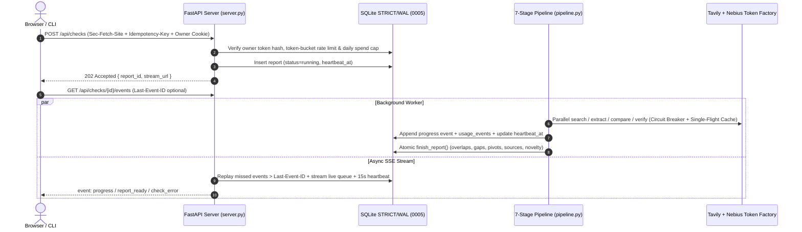
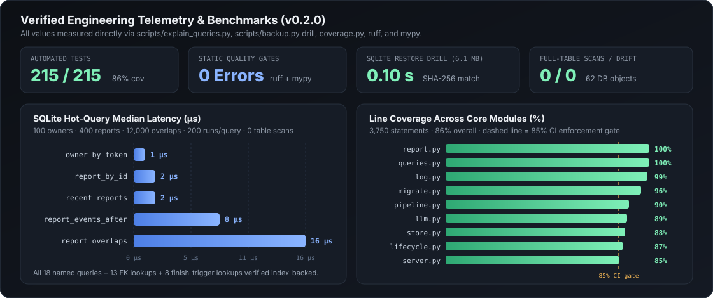

<p align="center">
  
</p>

<h1 align="center">Prior Art</h1>

<p align="center">
  <strong>Evidence-first prior-art research agent with feature-by-feature overlap grids, double-verified source quotes, and gap-targeted pivots.</strong>
</p>

<p align="center">
  <a href="https://github.com/coldrazer/priorArt/actions/workflows/ci.yml"></a>
  
  
  <a href="LICENSE"></a>
  
  
  
  
</p>

<p align="center">
  <a href="#live-product-preview">Preview</a> ·
  <a href="#why-prior-art">Why Prior Art</a> ·
  <a href="#architecture--two-stage-verification">Architecture</a> ·
  <a href="#verified-telemetry--benchmarks">Benchmarks</a> ·
  <a href="#quick-start">Quick Start</a> ·
  <a href="#api-security--persistence">API &amp; Security</a> ·
  <a href="#honest-failure--insufficient-evidence-handling">Failure Modes</a> ·
  <a href="#project-layout">Layout</a>
</p>

---

> **Prior Art** answers *"has someone already built this — and where is the whitespace?"* for builders, researchers, and founders. Instead of an unverified summary, it returns a **feature-by-feature overlap grid** where every *"already done"* cell opens the verbatim quote and numbered source behind it, and every quote survives **two independent checks** (deterministic code + a cross-family verifier LLM) before reaching your screen. Claims that fail stay visible — crossed out — with the exact reason.

---

## Live Product Preview

<p align="center">
  
</p>

*Every cell in the Overlap Grid is interactive and keyboard-navigable (roving `tabindex` + arrow keys). Selecting any cell opens the **Evidence Drawer** showing the verbatim page quote, Check A (deterministic code match), Check B (cross-family verifier verdict), injection warnings, and clickable numbered `[n]` source links.*

---

## Why Prior Art?

Checking prior art by hand means spending an hour sifting through GitHub, Hacker News, Product Hunt, arXiv, and Devpost — and still ending up with a vague *"kind of"*. Generic AI research agents often make it worse by confidently claiming a project *"already does X"* when its page says nothing of the sort.

| Capability | Manual Search | Generic Research Agent | **Prior Art** |
|---|---|---|---|
| **Multi-source sweep** | 45–90 min across tabs | Unbounded wandering | Fixed budget across **6 source types** (≤ 14 parallel queries) |
| **Feature-level mapping** | Ad-hoc notes | Prose paragraphs | Structured **4–7 feature × ≤ 8 project overlap grid** |
| **Hallucination defense** | Manual reading | Single-model trust | **2-stage check:** deterministic code match + cross-family LLM verifier |
| **Rejected claims** | — | Hidden silently | Shown **crossed out** with exact failure reason (`cut_quote` / `cut_verifier`) |
| **Prompt-injection resilience** | N/A | Vulnerable to page text | Random `<<<PAGE …>>>` JSON fencing + read-only tools + UI warning badges |
| **Low/no evidence honesty** | Ambiguous | Fabricates confidence | Explicit `no_close_match`, `insufficient_evidence`, and `failed` states |
| **Actionable output** | Raw links | Generic advice | Novelty score computed in code + **open gaps** + **3 gap-targeted pivots** |

---

## Architecture & Two-Stage Verification

<p align="center">
  
</p>

### How the Pipeline Works

1. **Decompose & Query Plan (Writer LLM):** Breaks the idea into **4–7 concrete, checkable features** (`F1`–`F7`) and writes tailored queries for **6 source types** (GitHub, Hacker News, Product Hunt, arXiv, Devpost, open web) using Tavily domain filters. Fixed budgets (≤ 14 searches, ≤ 8 shortlisted projects) guarantee predictable latency and bounded cost.
2. **Dedupe & Triage:** Results are deduplicated with query-safe URL normalization (preserving meaningful identifiers like `item?id=…` and `watch?v=…` while stripping tracking params). The writer filters out listicles, tutorials, and press roundups, merging duplicate sightings of the same project.
3. **Full-Page Extraction & Injection Scanning:** Tavily Extract reads full page contents with a per-URL SQLite cache (24 h TTL). Unreadable pages degrade gracefully to search snippets with explicit UI warnings. Pages containing instruction-like prompt injections are flagged transparently.
4. **Parallel Quote-Backed Comparison:** Up to 8 projects are compared concurrently against every feature. Untrusted web content reaches models **only** inside JSON payloads wrapped in per-request random `<<<PAGE …>>>` delimiters. Any overlap score > 0 must include a verbatim quote.
5. **Check A — Deterministic Code Verification (`quote_in_page`):** Plain Python confirms the quote actually appears on the extracted page (with Unicode/CJK/Arabic normalization and a negation-inversion guard). Invented quotes are immediately cut (`cut_quote`).
6. **Check B — Cross-Family LLM Verification:** A **different model family** reads *only* the feature claim and the verified quote (never the writer's reasoning) and confirms, downgrades (`Done → Partly`), or cuts (`cut_verifier`) anything the quote does not prove. Omitted or errored checks are explicitly labeled `unchecked` / `unverified` — never silently passed.
7. **Deterministic Scoring & Gap-Targeted Pivots:** The novelty score (`0–100`) is calculated strictly in Python from verified coverage alone. Open gaps (`max verified score = 0`) drive **3 concrete pivot proposals**, each grounded in numbered `[n]` citations.

<details>
<summary><strong>Runtime Request, SSE Replay &amp; Persistence Flow (Mermaid Diagram)</strong></summary>



</details>

---

## Verified Telemetry & Benchmarks

<p align="center">
  
</p>

All measurements below were captured directly against the v0.2.0 codebase (`Python 3.12`, `SQLite 3.53`).

### SQLite Hot-Query Benchmarks (`scripts/explain_queries.py`)

Tested against synthetic production volume (**100 owners · 400 reports · 12,000 overlap cells**, 200 iterations per query):

| Named Query | Access Plan (`EXPLAIN QUERY PLAN`) | Median Latency | Full-Table Scans |
|---|---|---:|---:|
| `owner_by_token` | `SEARCH owners USING INDEX sqlite_autoindex_owners_1 (token_hash=?)` | **1 µs** | 0 |
| `report_by_id` | `SEARCH reports USING INDEX sqlite_autoindex_reports_1 (id=?)` | **2 µs** | 0 |
| `recent_reports` | `SEARCH reports USING INDEX reports_owner_recent (owner_id=?)` | **2 µs** | 0 |
| `report_events_after` | `SEARCH report_events USING INDEX sqlite_autoindex_report_events_1` | **8 µs** | 0 |
| `report_overlaps` | `SEARCH overlaps USING INDEX overlaps_by_report_project` | **16 µs** | 0 |

> All **18 named queries**, **13 foreign-key lookups**, and **8 finish-trigger lookups** are verified index-backed with **0 full-table scans**. Online backup/restore drill (`scripts/backup.py drill`) verified a **6.1 MB** database round-trip with identical SHA-256 checksums in **0.10 s**.

### Quality & Supply-Chain Gates (Enforced in CI)

| Gate | Command | Result |
|---|---|---|
| **Bytecode compile** | `python -m compileall -q src scripts tests` | **PASS** |
| **Lint & style** | `ruff check src scripts tests` | **0 errors** |
| **Static typing** | `mypy src/priorart` | **0 errors** (21 modules) |
| **Automated tests** | `pytest -q` | **224 passed** |
| **Code coverage** | `coverage report --fail-under=85` | **87%** (4,233 stmts) |
| **Schema & migration drift** | `python scripts/db.py check` | **0 drift** (`0001`–`0005`, 62 objects) |
| **Supply chain** | `pip install --require-hashes -r requirements.txt` | **SHA-256 locked** + SHA-pinned GitHub Actions |

### Cost & Resource Guardrails

| Guardrail | Default | Configurable Via |
|---|---|---|
| Max shortlisted projects / run | `8` (hard bound `1–12`) | `PRIORART_MAX_CANDIDATES` |
| Max parallel search / model calls | `14` search · `8` model | `PRIORART_SEARCH_CONCURRENCY`, `PRIORART_MODEL_CONCURRENCY` |
| Per-check wall-clock deadline | `240 s` | `PRIORART_CHECK_DEADLINE_S` |
| Max concurrent active checks | `4` | `PRIORART_MAX_CONCURRENT_CHECKS` |
| Per-owner rate limits | `3 / 10 min` · `15 / day` | `PRIORART_RATE_LIMIT_10M`, `PRIORART_RATE_LIMIT_DAY` |
| Global rate limit | `60 / hour` | `PRIORART_RATE_LIMIT_GLOBAL_HOUR` |
| Daily spend ceiling | `5,000` Tavily credits · `2M` output tokens | `PRIORART_DAILY_BUDGET_CREDITS`, `PRIORART_DAILY_BUDGET_OUTPUT_TOKENS` |
| Repeat-run caching | SQLite WAL cache (24 h TTL + single-flight) | `PRIORART_CACHE=1` |

---

## Quick Start

### Local Installation

<!-- AUTO:setup -->
```bash
git clone https://github.com/coldrazer/priorArt
cd priorArt
python -m venv .venv && source .venv/bin/activate     # Python 3.11+
pip install --require-hashes -r requirements.txt
cp .env.example .env   # add your keys — never commit them
python src/agent.py config check                      # validates settings (secrets masked)
python src/agent.py models                            # confirms your two models are available
python src/agent.py "Your research question here"     # e.g. "Has anyone built a scam-call detector for aging parents?"
python src/agent.py serve                             # web UI at http://127.0.0.1:8000
```
<!-- /AUTO:setup -->

### Interactive Onboarding & Settings Wizard

Configure API keys and every setting without editing `.env` by hand — available in both the **Web UI** and the **CLI**:

- **Web UI Wizard (5 steps):** Start `python src/agent.py serve` and open `http://127.0.0.1:8000`. On first run (or anytime via **⚙ Setup & Settings**), the wizard walks you through:
  1. **API Keys & Mode:** Enter `NEBIUS_API_KEY` & `TAVILY_API_KEY` (masked, write-only, with live **Test API Connections** verification) or toggle **Offline Demo Mode**.
  2. **Cross-Family Models:** Choose writer & verifier models from curated presets or live-discovered Nebius models, with real-time cross-family verification warnings.
  3. **Pipeline & Performance:** Tune candidates, results/query, page char limit, concurrency, deadlines, and SQLite API caching.
  4. **Limits, Budgets & Paths:** Configure per-owner/global rate limits, daily credit & output-token ceilings, allowed hosts, proxy headers, and storage paths.
  5. **Review & Apply:** Saves atomically to `.env` with owner-only **`0600`** permissions and hot-reloads the running server immediately. *(Disabled automatically when `PRIORART_ENV=production`, and locked to `localhost`.)*
- **CLI Wizard:** Run `python src/agent.py setup` (or `onboard`) for an interactive terminal wizard using masked `getpass` key prompts.

### Zero-Key Offline Demo & CLI Flags

- **Try the full web UI immediately without API keys:**
  ```bash
  PRIORART_FAKE=1 python src/agent.py serve
  ```
  Runs the entire pipeline, SQLite persistence, SSE streaming, and UI against built-in demo data (clearly labeled *"offline demo data"*).
- **Export a cited Markdown report from any CLI run:**
  ```bash
  python src/agent.py "Your idea here" --md report.md
  ```
- **Inspect today's token & credit spend against your daily budget:**
  ```bash
  python scripts/usage.py
  ```

### Docker

```bash
docker build -t prior-art:0.2.0 .
docker run --rm -p 8000:8000 --env-file .env -v "$(pwd)/data:/app/data" prior-art:0.2.0
```

Runs as a non-root container (`priorart`), auto-applies SQLite migrations at startup, and exposes `/health/live` and `/health/ready` probes.

---

## Required Services

<!-- AUTO:services -->
| Requirement | How we use it |
|---|---|
| **Nebius Token Factory** (inference) | Two models from distinct families via the OpenAI-compatible API (`https://api.tokenfactory.nebius.com/v1/`). **Writer** (`meta-llama/Llama-3.3-70B-Instruct` by default): breaks the idea into features, plans queries, triages candidates, compares projects with verbatim quotes, and drafts pivots. **Verifier** (`Qwen/Qwen3-235B-A22B-Instruct-2507` by default): independently checks every overlap claim against its quote. |
| **Tavily** (real-time web search) | `search` (advanced depth, domain-filtered across GitHub, Hacker News, Product Hunt, arXiv, Devpost, and open web) discovers candidates; `extract` fetches full pages with per-URL caching. Every claim retains its source URL as a numbered `[n]` citation across the grid, verdict, pivots, and Markdown report. |
<!-- /AUTO:services -->

---

## Example Output

<!-- AUTO:example -->
**Question:** Build a research agent. *(ODSC × Nebius hackathon prompt)*

**Status:** Run a live check with your keys (`python src/agent.py "Build a research agent."`) and run `python scripts/submission.py fill` to auto-populate this block and generate `docs/example-report.md` from your latest live run.
<!-- /AUTO:example -->

---

## Honest Failure & Insufficient-Evidence Handling

Prior Art **never invents a novelty score** when evidence is missing or upstream tools fail. Every report carries an explicit status:

| Status | Trigger Condition | Guaranteed Behavior |
|---|---|---|
| `ok` | Projects found and compared | Full grid, code-computed novelty score, gaps, pivots, `[n]` sources |
| `no_close_match` | Searches succeeded, but zero overlap claims survived both checks | Score shown, explicitly badged **Low evidence** (absence of evidence ≠ proof) |
| `insufficient_evidence` | Searches returned zero usable results | **No score**, no pivots |
| `failed` | Every search failed, or every comparison failed | **No score**, no pivots; CLI exits with code `2` |

Partial failures degrade transparently and are surfaced directly in both the web UI and Markdown exports:
- failed search sources are named individually;
- unreadable extraction URLs fall back to search snippets with a visible badge;
- verifier outages mark affected claims **Unchecked / Unverified** rather than letting them pass silently.

Simulate an outage on demand (clearly labeled as simulated):

```text
$ python src/agent.py "Build a research agent." --simulate search_down
==============================================================================
NO SCORE (failed)   ·   <the idea, restated>
==============================================================================
⚠ All 12 searches failed (Tavily unreachable?). No novelty score is given, because there is no evidence to base it on.
```

In the web UI, select **Failure demo: Tavily search down** or **Failure demo: page reading down** right beside the **Check it** button.

---

## API, Security & Persistence

### HTTP & SSE Endpoints

| Endpoint | Method | Description |
|---|---|---|
| `/` & `/r/{report_id}` | `GET` | Single-page WCAG AA UI & shareable report deep links |
| `/api/checks` | `POST` | Starts an async check (`Sec-Fetch-Site`/`Origin` verified, `Idempotency-Key` supported, rate-limited) |
| `/api/checks/{id}/events` | `GET` | Async Server-Sent Events stream with `Last-Event-ID` replay & 15 s heartbeats |
| `/api/reports` & `/api/reports/{id}` | `GET` / `DELETE` | Owner-scoped report history, detail JSON, Markdown download (`/report.md`), soft-delete & `/restore` |
| `/api/me/export` & `/api/me` | `GET` / `DELETE` | GDPR-style owner data export (JSON) and full owner data erasure |
| `/api/setup` & `/api/setup/test` | `GET` / `POST` | Local-only onboarding & settings wizard + live API key test (disabled in production, `0600` `.env`, hot-reload) |
| `/health/live`, `/health/ready`, `/version` | `GET` | Liveness probe, SQLite/migration readiness check, and build version |

### Security Controls

Defense-in-depth across the LLM pipeline, FastAPI server, and persistence layer:
- **CSRF & Paid-Work Guard:** Legacy `GET /api/run` is retired (`405`). Checks launch strictly via `POST /api/checks` with browser fetch-metadata checks, owner/global SQLite token buckets, and daily spend caps.
- **Anonymous Owner Isolation:** 256-bit `HttpOnly` cookies (`__Host-pa_owner` in production/HTTPS, `pa_owner` on localhost HTTP) stored strictly as SHA-256 hashes; cross-owner reads/streams/deletes return `404`.
- **Browser Hardening:** Dynamic SHA-256 Content-Security-Policy (`frame-ancestors 'none'`, zero inline styles), `TrustedHostMiddleware` (DNS rebinding guard), `X-Content-Type-Options: nosniff`, `Referrer-Policy: no-referrer`, and HSTS in production.
- **Structured Redacted Logging:** JSON logs automatically redact API keys, bearer tokens, cookies, emails, and user idea text; clients receive opaque error references (`err_…`).

### Database & Deterministic Seeded Fixtures

The server persists reports, SSE events, rate-limit buckets, and usage telemetry in SQLite (`data/priorart.sqlite`, schema `0005`, `STRICT` tables, `WAL` mode, `foreign_keys = ON`, auto-migrated at startup).

```bash
python scripts/db.py up        # apply migrations (0001–0005)
python scripts/db.py check     # verify up/down/re-up & 0 drift against schema.sql
python scripts/seed.py         # load deterministic local fixtures (blocked in production)
python scripts/backup.py drill # verify online backup + SHA-256 restore integrity
```

<details>
<summary><strong>Seeded Local Test Owners (Non-Production Fictional Fixtures)</strong></summary>

There are no logins or passwords. An owner is an anonymous browser cookie token whose SHA-256 hash is stored in SQLite. All seeded data uses fictional projects on reserved `example.com` / `example.org` / `example.net` domains.

| Owner | ID | Local Test Token | Purpose |
|---|---|---|---|
| **new** | `900001` | `priorart-seed-new` | Zero reports — verifies every first-use and empty UI state |
| **typical** | `900002` | `priorart-seed-typical` | Six reports covering every status: complete (`SdTypOk001`), low evidence (`SdTypNcm01`), insufficient evidence (`SdTypIns01`), failed (`SdTypFail1`), pivot chain (`SdTypPvt01`), and in-flight running (`SdTypRun01`) |
| **heavy** | `900003` | `priorart-seed-heavy` | 120 reports of history + boundary-cap report (`SdHvyCaps1`: 4,000-char idea, 7 features, 14 searches, 8 projects, 3 pivots, Japanese/Arabic RTL/emoji text, injection flag, snippet fallback, unverified claim) |

</details>

---

## Project Layout

```text
priorArt/
├── src/priorart/           # Core Python package (pipeline, llm, search, cache, store, server, onboarding, resilience, log)
│   └── static/index.html   # Zero-inline-style, WCAG AA single-page web app + 5-step Setup Wizard
├── migrations/             # Reversible SQLite migrations (0001–0005, up & down)
├── scripts/                # CLI ops: db.py, seed.py, backup.py, data.py, explain_queries.py, usage.py, submission.py
├── tests/                  # 224 automated offline tests (87% coverage across pipeline, onboarding, DB, lifecycle, security, API)
├── docs/assets/            # Hero banner & dark-mode SVG architecture/benchmark charts
├── .github/                # SHA-pinned CI workflow & issue templates
├── Dockerfile              # Non-root Python 3.12 production container
├── pyproject.toml          # Packaging, Ruff, Mypy & Pytest configuration
└── requirements*.txt       # Universal SHA-256 hashed dependency lockfiles
```

---

## ODSC × Nebius Hackathon Submission

- **Challenge:** *Build a research agent that brings its sources*
- **Team:** Apex Studio
- **Demo video (2–3 min):** *(add via `python scripts/submission.py fill --video <url>`)*

| Criterion | Weight | Where to Look |
|---|---:|---|
| **Sourced & verifiable answers** | 30% | [Overlap Preview](#live-product-preview), verbatim quote drawer, numbered `[n]` citations, visible rejected claims |
| **Works end to end** | 25% | [Quick Start](#quick-start), `pytest -q` (224 passing), [Failure Modes](#honest-failure--insufficient-evidence-handling), Docker build |
| **Usefulness** | 20% | [Why Prior Art](#why-prior-art), open gap detection, 3 gap-targeted pivots with one-click follow-up checks |
| **Agent design** | 15% | [Architecture](#architecture--two-stage-verification), [`src/priorart/pipeline.py`](src/priorart/pipeline.py), 2-stage deterministic + cross-family verification |
| **Use of Token Factory & Tavily** | 10% | [Required Services](#required-services), [`src/priorart/llm.py`](src/priorart/llm.py), [`src/priorart/search.py`](src/priorart/search.py) |

---

## License

Distributed under the [MIT License](LICENSE) (`Copyright (c) 2026 Apex Studio`).
