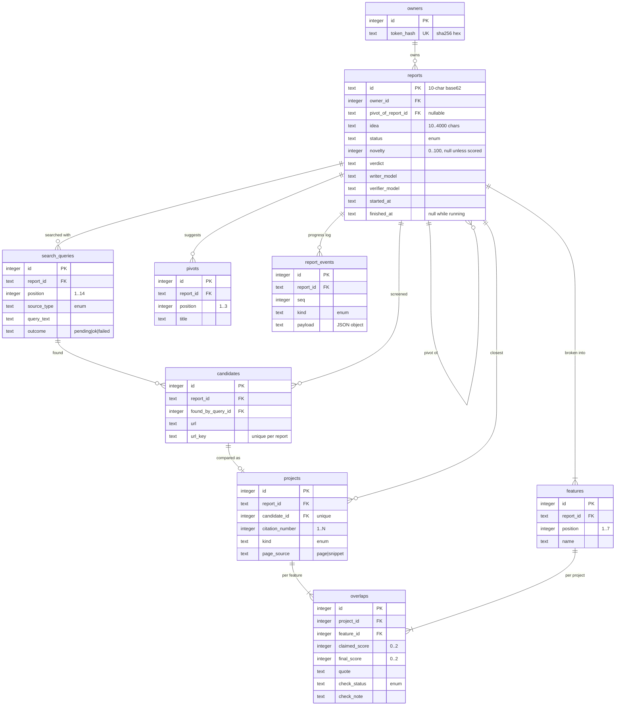

# Prior Art — Data Model

Phase 03 · Prompt 03.1 · Status: **implemented**: `src/priorart/schema.sql`, applied by migration `migrations/0001_initial` (see `docs/MIGRATIONS.md`)

## 0. Basis and conflicts

- **No PRD or acceptance criteria exist.** `docs/PRD.md` and the 01.3 acceptance criteria aren't in the repository. The requirements in §1 are derived from:
  - the project pitch;
  - `README.md`;
  - the proposed Phase 09 docs (`docs/UX_ARCHITECTURE.md`, `docs/USER_JOURNEYS.md`, `docs/STATE_MATRIX.md`; none approved yet);
  - what the code actually produces.
- **Today there is no database for user data.** Each finished check is written as one JSON file named `<timestamp>-<idea slug>.json` (`src/priorart/pipeline.py:404–408`). The only SQLite use is an API-response cache, a single key/value table (`src/priorart/cache.py:23–24`). That cache is infrastructure, not user data, and stays out of this model (§7).
- **The shape of a report** comes from what the pipeline builds (`src/priorart/pipeline.py:376–398`): features, queries, projects with per-feature cells, sources, coverage, gaps, novelty, check totals, verdict and pivots.
- **Conflicts with today's code.** These are flagged, not fixed; each becomes a Follow-up:
  1. **A skipped claim is marked "verified".** When the verifier skips a claim, the pipeline marks it `verified` with no reason (`pipeline.py:234`). The model calls that `unverified`, because it was never checked by the verifier.
  2. **A rejection can have no reason.** A verifier rejection can be stored with an empty reason (`pipeline.py:247`, `str(v.get("reason", ""))`). The schema requires a reason for every rejected or downgraded overlap, so the pipeline must supply a default.
  3. **One status, two names.** The pipeline's in-progress cell status is `claimed` (`pipeline.py:205`); the model's user-facing label is `unverified`. They mean the same thing: past the quote check, not confirmed by the verifier.
  4. **Ownership.** The prompt requires an ownership column on all user data, but 09.1 proposes no accounts in v1 (Decision A, not yet approved). The model reconciles the two with an anonymous **owner**: a random browser token, stored only as its SHA-256 hash. Accounts can later claim those rows (tested: `owner_id` changes cascade).

## 1. Must requirements this model covers

| # | Requirement (source) | Entities |
|---|---|---|
| M1 | Submit an idea, get a report (pitch; `pipeline.py:264`) | owners, reports |
| M2 | Break the idea into 4–7 features (`pipeline.py:102`) | features |
| M3 | Search 6 source types, up to 14 queries (`search.py:10–16`, `pipeline.py:122`) | search_queries |
| M4 | Deduplicate results into candidates (`pipeline.py` `norm_url`) | candidates |
| M5 | Compare existing projects feature by feature, each overlap backed by a quote (`pipeline.py:194–206`) | projects, overlaps |
| M6 | Two-stage check; rejected claims stay visible with a reason (`pipeline.py:210–250`) | overlaps (`check_status`, `check_note`) |
| M7 | Novelty score from checked coverage only; gaps (`pipeline.py:73–76`) | reports.novelty, views |
| M8 | Up to 3 pivots (`pipeline.py:260`) | pivots |
| M9 | Numbered sources [n] that never change (`pipeline.py:341`; 09.1 §5) | projects.citation_number |
| M10 | Honest statuses: ok / no_close_match / insufficient_evidence / failed (`pipeline.py:378`) | reports.status |
| M11 | Shareable, unguessable report links (09.1 §5, proposed) | reports.id |
| M12 | Resume a running check after leaving (09.2 J5, proposed) | report_events |
| M13 | "Pivot of" link between reports (09.2 J3, proposed) | reports.pivot_of_report_id |

## 2. Entity-relationship diagram

Every table except `owners` also has `owner_id`, and every table has `created_at` and `updated_at` (omitted from the diagram).

## 3. Engine and conventions

| Choice | Decision | Why |
|---|---|---|
| Engine | **SQLite ≥ 3.37 with STRICT tables** (recommended; Decision 1) | Prior Art runs as a local app (`python src/agent.py serve`) and the hackathon judges run it with `pip install` only. SQLite needs no server and is already in use (`cache.py`). STRICT tables reject wrong types. Verified on SQLite 3.53.1. |
| Primary keys | `reports.id`: random 10-character base-62 text. All other tables: `INTEGER PRIMARY KEY`. | The report id appears in URLs (09.1 §5), so it's unguessable and never derived from the idea. Child ids are internal; URLs address children by `citation_number` and feature `position`, which are frozen per report. |
| Enums | `TEXT` with `CHECK (col IN (…))` | SQLite has no enum type. A CHECK gives the same guarantee and is listed in every table. |
| Timestamps | `TEXT` holding UTC ISO-8601 with milliseconds and a literal `Z`, enforced by a `GLOB` CHECK; default `strftime('%Y-%m-%dT%H:%M:%fZ','now')` | Timezone-aware by construction, sorts correctly as text, and malformed or local-time values are rejected |
| `updated_at` | Maintained by an `AFTER UPDATE` trigger on every mutable table | Correct even when the app forgets |
| Money | None in this domain | The only fractional value is `candidates.search_score`, a 0–1 relevance score from Tavily: `REAL` is appropriate and nothing is summed as currency |
| Ownership | `owner_id` on every user-data table, tied to the report's owner by a composite foreign key `(report_id, owner_id) → reports(id, owner_id)` | Rows can't belong to a different owner than their report, and filtering by owner never needs a join |
| Foreign keys | Enforced with `PRAGMA foreign_keys = ON` on every connection (done by the connection helper in §8) | SQLite doesn't enforce foreign keys unless asked |

**PostgreSQL mapping** (if Decision 1 goes the other way):
- `TEXT CHECK IN` becomes native enums;
- timestamp text becomes `timestamptz`;
- `INTEGER PRIMARY KEY` becomes `bigint generated always as identity`;
- `json_valid` becomes `jsonb`;
- the triggers carry over almost line for line.

## 4. Tables

All tables are in third normal form except for the four deliberate denormalizations marked ★. Each is justified here and in a comment in the schema.

| Table | Rationale |
|---|---|
| **owners** | The anonymous owner of a browser's reports. Only `token_hash` (SHA-256 hex) is stored, never the cookie token, so a database leak can't be used to impersonate an owner. Deleting an owner deletes everything they own (cascade): a privacy-first default. |
| **reports** | One check of one idea: status, the score and verdict shown, models used, timing, demo-mode flag (`simulate`, `__init__.py:41`). ★ `novelty` is stored even though it's derivable from overlaps, because it's the number the user was shown; a trigger keeps it within 0.5 of the recomputed value. Python's rounding (`pipeline.py:76`) and SQLite's can differ by one at .5, hence the tolerance. Counts such as candidates found and claims checked are **not** stored; they come from views. |
| **features** | The 1–7 parts of the idea, in order. `position` is the user-visible F1…F7 (09.1 §5), unique per report. |
| **search_queries** | The planned queries, their source type and outcome. `pending` lets a running report show progress. Outcome rules: `ok` needs a result count, `failed` needs an error message. Query text is capped at 390 characters, as the pipeline sends it (`search.py:31`). |
| **candidates** | Unique search results per report, with the query that first found each. ★ `url_key` (the normalized URL) is stored so the database can enforce one candidate per page per report; the normalization (`pipeline.py` `norm_url`) can't be expressed in a CHECK. Snippets are capped at 600 characters, as the pipeline stores them (`search.py:41`). |
| **projects** | Candidates that made it to comparison. One per candidate (`UNIQUE candidate_id`). `citation_number` is null while comparing and must run 1…N without gaps when the report finishes. The source type is reached through candidate → query, not copied. |
| **overlaps** | The grid: one row per project × feature, with the claimed score, the score after checks, the quote, the check verdict and its reason. ★ `report_id` repeats what `project_id` and `feature_id` imply; it's what lets two composite foreign keys prove both belong to the same report. |
| **pivots** | Up to 3 suggestions per report, in order. They're only allowed on reports that end with a score. |
| **report_events** | ★ An append-only log of the progress events the UI streams (`index.html`, event names at `:248–261`). Payloads repeat table data; the log exists so a reopened page can replay a running check (09.2 J5). The tables remain the source of truth. |

**Views** (derived data, so it can never disagree with the facts):
- `feature_coverage`: best score and number of covering projects per feature;
- `report_gaps`: features with best score 0;
- `report_check_totals`: checked, cut_quote, cut_verifier, downgraded, unverified;
- `report_candidate_counts`.

## 5. ON DELETE behavior

| Foreign key | ON DELETE | Why |
|---|---|---|
| reports.owner_id → owners | CASCADE | Deleting an owner removes their data |
| reports.pivot_of_report_id → reports | SET NULL | A pivot report stands on its own if its parent is deleted |
| features, search_queries, candidates, projects, overlaps, pivots, report_events → reports (report_id, owner_id) | CASCADE (and ON UPDATE CASCADE) | Parts of a report have no meaning without it. ON UPDATE lets a future account claim an anonymous owner's reports. |
| candidates → search_queries | CASCADE | A candidate exists because a query found it |
| projects → candidates | CASCADE | A project's evidence trail starts at its candidate. RESTRICT was rejected because it would block a report's own cascade delete. |
| overlaps → projects, overlaps → features | CASCADE | A cell needs both its row and its column |

## 6. Invariants and the constraint that enforces each

| # | Invariant | Enforced by |
|---|---|---|
| I1 | An idea is 10–4,000 characters (`server.py:73`) | `reports` CHECK |
| I2 | An idea never changes once its check starts | trigger `reports_idea_immutable` |
| I3 | Report ids are 10 base-62 characters | `reports.id` CHECK |
| I4 | Raw owner tokens are never stored | `owners.token_hash` CHECK (64 hex chars), UNIQUE |
| I5 | Running ⇔ no finish time; finish ≥ start | `reports` CHECKs |
| I6 | A score exists exactly when status is ok or no_close_match: no score is never shown as 0 | `reports` CHECK on novelty vs status |
| I7 | A scored report has a summary; every status except running and ok explains itself | `reports` CHECKs |
| I8 | A finished report is read-only (deletion still allowed) | trigger `reports_finished_immutable`; `*_insert_while_running` / `*_update_while_running` triggers on every child table |
| I9 | A scored report has ≥ 1 feature and a complete grid (projects × features) | trigger `reports_finish_rules` |
| I10 | Citation numbers are unique and run 1…N with no gaps when a report finishes | UNIQUE `(report_id, citation_number)`; trigger `reports_finish_rules` |
| I11 | `ok` has at least one checked overlap; `no_close_match` has none | trigger `reports_finish_rules` |
| I12 | Reports without a score have no pivots | trigger `reports_finish_rules` |
| I13 | The stored novelty matches checked coverage (±0.5) | trigger `reports_finish_rules` |
| I14 | Every overlap claim carries a quote; no claim, no quote | `overlaps` CHECKs |
| I15 | Checks can lower a score, never raise it | `overlaps` CHECK `final_score <= claimed_score` |
| I16 | Rejected ⇒ score 0; verified or unverified ⇒ score unchanged; downgraded ⇒ strictly lower and above 0 | `overlaps` CHECKs |
| I17 | Every rejected or downgraded overlap says why | `overlaps` CHECK on `check_note` |
| I18 | Evidence quotes have at least 3 words (as the code's quote check requires, `pipeline.py` `quote_in_page`) | `overlaps` CHECK |
| I19 | A cell's project and feature belong to the same report | composite foreign keys on `(project_id, report_id)` and `(feature_id, report_id)` |
| I20 | Every row's owner is its report's owner | composite foreign key `(report_id, owner_id)` on every child table |
| I21 | One candidate per page per report; one project per candidate | UNIQUE `(report_id, url_key)`; UNIQUE `candidate_id` |
| I22 | Source types, statuses, kinds and outcomes come from fixed lists | CHECK `IN (…)` on each enum column |
| I23 | Search outcomes are consistent (ok ⇒ count; failed ⇒ error) | `search_queries` CHECKs |
| I24 | Size caps match the pipeline: ≤ 7 features, ≤ 14 queries, ≤ 3 pivots, query ≤ 390, snippet ≤ 600, injection excerpt ≤ 60 chars | CHECKs (`pipeline.py:102,122,260,70`; `search.py:31,41`) |
| I25 | The progress log is append-only, ordered, and valid JSON | UNIQUE `(report_id, seq)`; CHECK `json_valid`; trigger `report_events_append_only` |
| I26 | A report can't be a pivot of itself | `reports` CHECK |
| I27 | All timestamps are UTC ISO-8601 with 'Z'; `updated_at` moves on every change | GLOB CHECKs; `*_touch` triggers |
| I28 | Column types are exact (no text in integer columns) | `STRICT` tables |

**How these were verified:** 30 tests against SQLite 3.53.1 in a scratch folder outside the repository. Each invariant above has at least one test that the violation is rejected, plus one full valid report lifecycle. The tests cover cascades on owner and report deletion, the pivot SET NULL, and an owner change cascading after a report finished. They move into `tests/test_schema.py` on Go.

## 7. Deliberately not modeled

- **Page text.** It isn't saved today (`pipeline.py:342`) and stays out: size, and republishing third-party pages. Consequence: a finished report's quote check can't be re-run from the database alone.
- **The API cache** (`cache.py`). Infrastructure keyed by request hash, not user data. It stays in its own file and table.
- **Accounts, sessions, rate limits.** These depend on 09.1 Decision A; see Follow-ups.

## 8. Implementation (done in 03.2 after "Go")

| File | Change |
|---|---|
| `src/priorart/schema.sql` | **New.** The schema exactly as tested: 9 tables, 4 views, 25 triggers. |
| `src/priorart/db.py` | **New.** `connect(path)`: <ul><li>refuses SQLite below 3.37 with a clear message;</li><li>sets `PRAGMA foreign_keys = ON` and WAL mode;</li><li>applies `schema.sql` to an empty database;</li><li>records the version in `PRAGMA user_version = 1`;</li><li>refuses a database stamped with an unknown version.</li></ul> |
| `tests/test_schema.py` | **New.** The 30 invariant tests, run through `db.connect`. |

Nothing else changes. The pipeline, server and UI keep writing JSON files until a later phase moves storage to the database. So implementing this now doesn't touch the hackathon demo.

**Verification after Go:**
- `python -m pytest -q`: the full suite, existing 24 plus the new tests;
- `python -m compileall -q src`.

The repo has no type checker or linter configured (no `pyproject.toml`, ruff, flake8 or mypy config). I'll report that rather than claim a lint pass.

**Decisions:**
1. **SQLite** (recommended) or PostgreSQL.
2. **Anonymous browser owners** as the ownership column (recommended; matches 09.1 Decision A).
3. **Go** to implement the three files above.

## Follow-ups (out of scope for this phase)

- **Pipeline fixes to satisfy the model** (conflicts 1–3 in §0):
  - a verifier-skipped claim should become `unverified`, not `verified` (`pipeline.py:234`);
  - a verifier rejection needs a default reason when the model gives none (`pipeline.py:247`);
  - rename the in-progress `claimed` status to `unverified` (`pipeline.py:205`).
- **Repository layer** to write reports, events and grid rows to the database instead of JSON files (`pipeline.py:404–408`), and serve `/r/{id}` from it (09.1).
- **Owner cookie:** issue the random token as an HttpOnly, SameSite=Lax cookie, look up the owner by its hash, and scope "Recent reports" to the owner (fixes the global `/api/runs` listing, `server.py:32–45`).
- **Migrations beyond v1:** a migration runner keyed on `user_version` (Phase 03 follow-on prompts).
- **Retention:** how long anonymous reports and events are kept; event log compaction once a report finishes.
- **Accounts** if 09.1 Decision A is reversed: an accounts table; owners gain a nullable `account_id`; claiming moves `owner_id` (cascade already tested).
