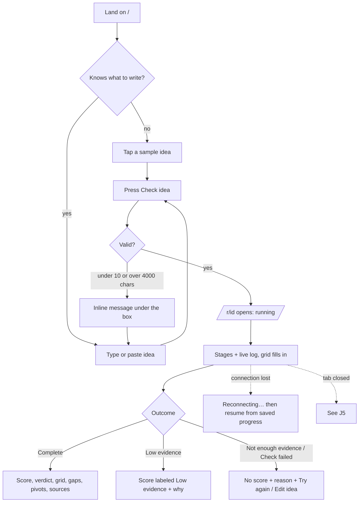
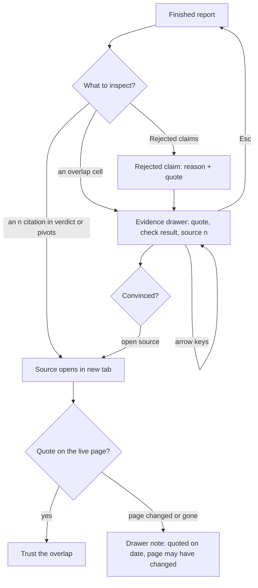
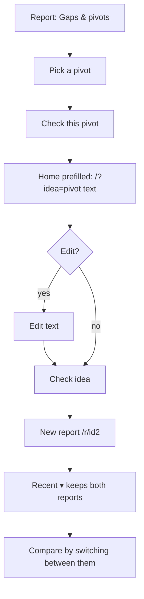
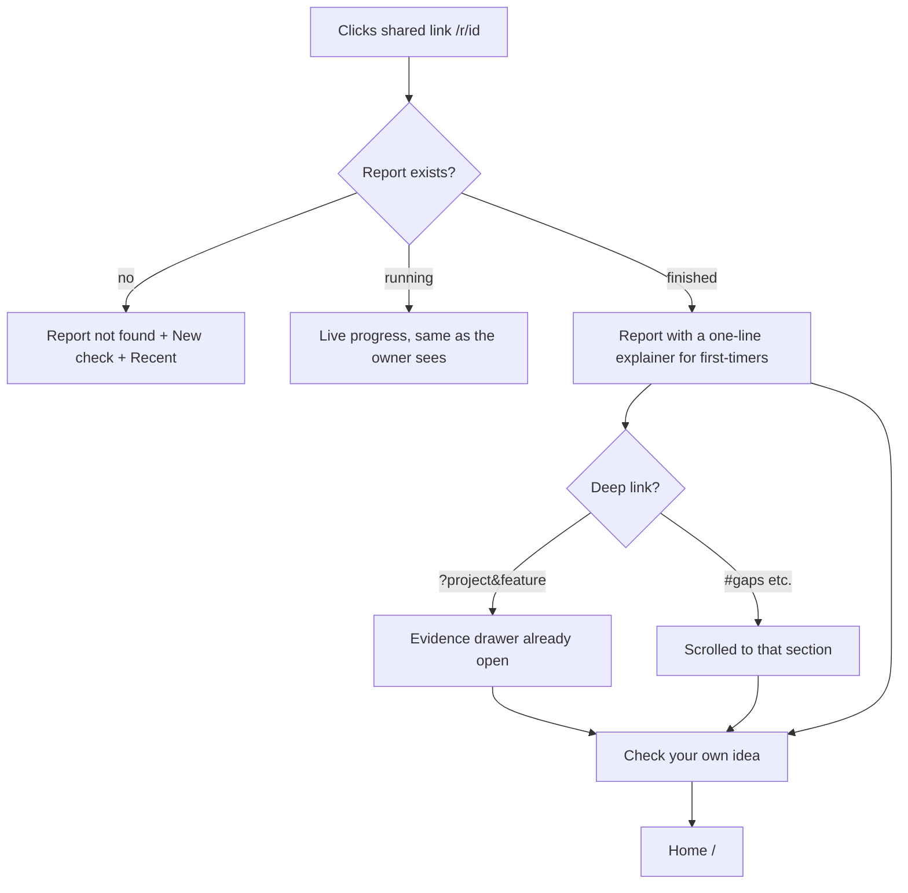
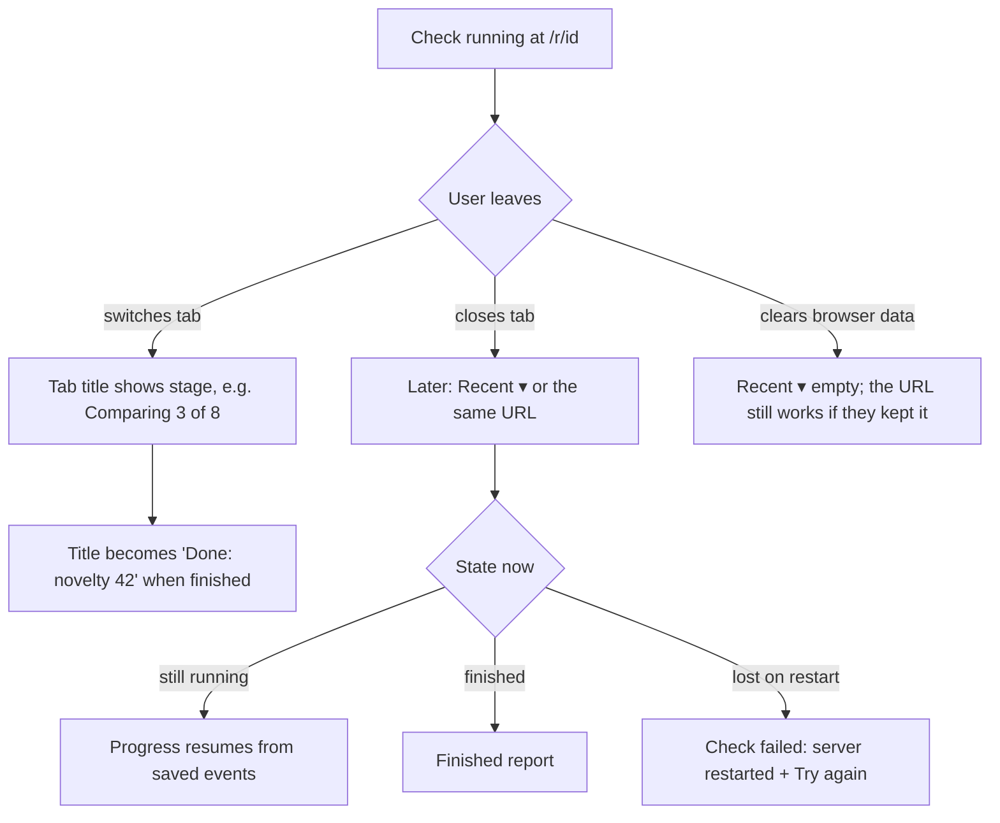

# Prior Art — Core User Journeys

Phase 09 · Prompt 09.2 · Status: **proposed**

## 0. Basis and conflicts

- **Depends on 09.1.** `docs/UX_ARCHITECTURE.md` exists but is marked **proposed, awaiting approval** (`docs/UX_ARCHITECTURE.md:3`). These journeys use its routes (`/`, `/r/{reportId}`, the evidence drawer `?project=&feature=`) and its labels (Idea, Check, Report, Overlap, Evidence, Rejected claim, Gap, Pivot). If 09.1 changes, this document changes with it.
- **No other earlier-phase docs** exist in `docs/`. Everything else here is derived from the code, cited by file and line.
- **"Today" vs "Designed".** Every step is marked **Today** (what the code does now) or **Designed** (behavior to build). Nothing marked Designed exists yet.
- **"About two minutes" is unmeasured.** No live check against Token Factory and Tavily has been run from this repo. The upper bound is long: each model call can take up to 120 s (`src/priorart/llm.py:46`) and is retried up to 3 times (`src/priorart/llm.py:79`). Journeys below treat the wait as **unknown, possibly several minutes** until it's measured (see Follow-ups).
- **There are no accounts, email or sessions** in the repo. "Permission denied" and "expired session" are mapped to what actually exists: service keys, unlisted report links, and browser storage. Section 7 explains each mapping.

## 1. Journeys that matter most

| # | Journey | Why it matters |
|---|---|---|
| J1 | **First visit → first report** | The core value loop. Everything depends on it. |
| J2 | **Prove or doubt an overlap** | The product's promise: "every claim links to the page that proves it". |
| J3 | **Follow a pivot into a new check** | The repeat loop. It turns one answer into an iteration. |
| J4 | **Arrive cold from a shared report link** | How "everyone" mostly finds Prior Art: a teammate's or judge's link. |
| J5 | **Leave during a check and come back** | The wait is the longest moment in the product, and people will leave. |

## 2. Steps and decisions before first value

**First value** is the moment the user sees the verdict and novelty score for their own idea.

| | Today | Designed |
|---|---|---|
| Steps | 3: land → enter idea → press **Check it** (`index.html:124`), then wait | 3: land → enter idea or tap a sample → press **Check idea**, then wait |
| Decisions | 1: what to write | 1: what to write, made easier with an inline example and samples |
| Wait | Unmeasured (§0) | Same compute time, but the URL exists from the start, the grid fills in as projects are compared, and the tab title shows progress |
| First *proof* (an overlap opened to its quote) | +1 click (a cell → drawer) | +1 click, or 0 by hovering a cell for a quote preview |

Nothing before first value needs a sign-up, settings or configuration.

## 3. Journeys

### J1 — First visit → first report

| # | Screen | User action | System response | User sees next |
|---|---|---|---|---|
| 1 | Home `/` | Arrives | Shows the idea box and samples. **Today:** two sample chips (`index.html:125–126`) and a placeholder line (`:122`). | An empty box with an example of a good idea and two samples |
| 2 | Home | Types, pastes, or taps a sample | **Designed:** live character count and a hint when the idea is too short to break into features | The idea in the box; **Check idea** enabled once it's 10+ characters |
| 3 | Home | Presses **Check idea** | **Today:** opens a stream to `GET /api/run?idea=…` (`index.html:247`, `server.py:72–73`), and the work runs in a background thread (`server.py:92`). **Designed:** `POST` creates the report and returns its id, then the browser goes to `/r/{id}`. | The Report in its running state |
| 4 | Report (running) | Watches | Stages advance: Features → Search → Screen → Read pages → Compare → Check claims → Open space (`index.html:197`). Each event comes from `pipeline.py:264` onwards. **Designed:** features appear first, then grid rows as each project is compared. | Live progress and a growing grid |
| 5 | Report (finished) | Reads | Status banner, novelty score, verdict with [n] citations, grid, gaps and pivots, rejected claims, sources (`index.html:273–339`) | First value: the verdict for their own idea |

**Unhappy paths in J1**

| Step | Case | Today (cited) | Designed |
|---|---|---|---|
| 2–3 | **Validation: too short** (< 10 chars) | The button just refocuses the box with no message (`index.html:238`). The server also rejects it (`server.py:73`, `pipeline.py:267–268`). | Message under the box: "Describe the idea in at least a sentence: who it's for and what it does." The button stays disabled until it's valid. |
| 2–3 | **Validation: too long** (> 4000 chars) | The server rejects the request (`server.py:73`). The browser's stream gets an error with no data, so the run silently stops and nothing is shown (`index.html:256–260`). | Counter turns red past 4,000: "Trim to 4,000 characters. The first paragraph usually carries the features." |
| 3 | **Validation: idea too vague to break into features** | `RuntimeError` "Couldn't break the idea into features…" (`pipeline.py:108`) arrives as an error event and shows in the error banner | Same message on Home with the idea still in the box, plus one example rewrite |
| 3 | **Permission denied: service keys missing or rejected** | Missing keys raise a setup error (`__init__.py:22`). A rejected key raises "Token Factory rejected the API key" (`llm.py`, AuthenticationError branch). Both show in the error banner. | Visitors see "Prior Art can't run checks right now", not key names. Key names appear only in the server log. Home stays usable for reading existing reports. |
| 4 | **Network loss mid-check** | The stream's error handler stops listening and re-enables the button (`index.html:256–263`). The server keeps working and saves the result (`server.py:92`, `pipeline.py:404–407`), but the user isn't told and has no link back except "Past runs". | "Reconnecting…" banner. On reconnect the Report reloads `/r/{id}` and resumes from its saved progress. After 30 s offline: "You're offline. The check is still running on the server; this page will update when you're back." |
| 4 | **Empty data: searches return nothing** | Status `insufficient_evidence`: no score, a reason, stages after Search struck through (`pipeline.py`, `stop()`; `index.html` `setStage`) | Same, plus **Edit idea** and **Try again** buttons |
| 4 | **Service outage** | All searches failing → status `failed`, "No novelty score is given…" (`pipeline.py`, `stop()`). Unreadable pages → snippet fallback with a note. A verifier outage is reported in the banner. | Same messages, with **Try again**. Retrying the same idea reuses cached work (`search.py:46,60`, `cache.py`), so it's faster. |
| 4 | **Abandons midway** (closes tab) | The check finishes on the server and is saved; the user can only find it in "Past runs" (`index.html:132`), which lists every visitor's runs (`server.py:32–45`) | The report URL already exists. It's added to **Recent ▾** at the start, and reopening it shows the current state (J5). |
| 5 | **Server restarted mid-check** | The background thread dies (`server.py:92`), the run is lost, and nothing records that it was ever started | Report shows **Check failed: the server restarted during this check** with **Try again** |

### J2 — Prove or doubt an overlap

| # | Screen | User action | System response | User sees next |
|---|---|---|---|---|
| 1 | Report | Clicks a red or amber cell | Opens the drawer (`index.html:342`). **Designed:** the URL becomes `?project={n}&feature={id}`. | Feature, project, overlap value, quote, check result, source [n] |
| 2 | Evidence drawer | Reads the quote and check result | Labels: verified, downgraded, rejected (quote not on the page / quote doesn't prove it), or unverified when the verifier failed | Whether this claim held up and why |
| 3 | Evidence drawer | Opens the source | The page opens in a new tab (`rel="noopener"`) | The project's own page |
| 4 | Source tab | Finds the quote (browser Find) | **Designed:** the drawer offers **Copy quote**, ready for the Find box | Confirmation on the live page |
| 5 | Report | Presses Esc or ✕, or arrows to the next cell | **Today:** Esc closes (`index.html:217`). **Designed:** arrow keys move along the row. | Back at the grid, at the same scroll position |

**Unhappy paths in J2**

| Step | Case | Today | Designed |
|---|---|---|---|
| 1 | **Empty data: an Open cell** | The drawer says "No evidence: this feature looks open here" | Same, plus "Open means nothing on this project's page showed it, not that nobody does it." |
| 2 | **Page was only a snippet** | Note in the drawer: "Full page couldn't be read…" | Same; the cell gets a small "snippet" marker in the grid too |
| 3 | **Source page gone or changed** | Nothing; the user finds a dead or different page | Drawer shows "Quoted on {report date}" so the user knows the quote reflects the page at check time |
| 3 | **Permission denied: login wall or paywall** | The source opens to a login or paywall page | Drawer shows the domain before opening, and the quote is always readable in the drawer itself |
| 3 | **Network loss** | The browser's own offline page in the new tab | Not ours to handle; the quote stays readable in the drawer |
| any | **Abandon and return** | The drawer state is lost and there's no URL | The drawer URL reopens the same cell (09.1 §5) |

### J3 — Follow a pivot into a new check

| # | Screen | User action | System response | User sees next |
|---|---|---|---|---|
| 1 | Report | Reads **Gaps & pivots** | Pivot cards: title, pitch, which gap it uses (`index.html`, pivots render) | Three variations aimed at open features |
| 2 | Report | Presses **Check this pivot** | **Today:** no such action; the user must copy the text by hand. **Designed:** goes to `/?idea=<pivot title + pitch>`. | Home with the pivot in the box, not yet running (no credits spent by accident) |
| 3 | Home | Edits if wanted, presses **Check idea** | New check | J1 steps 3–5 |
| 4 | New report | Compares with the original | **Designed:** the header shows "Pivot of: {original idea}" linking back | Two reports, one click apart |

**Unhappy paths in J3**

| Step | Case | Designed |
|---|---|---|
| 1 | **Empty data: no pivots** (failed or not-enough-evidence status) | "Pivots need evidence. Try again or edit the idea." (**Today:** "Skipped: no evidence to base pivots on.") |
| 2 | **Validation: pivot text over 4,000 characters** | Can't happen; pivots are one sentence. Truncation is guarded anyway. |
| 3 | **Network loss / outage** | As in J1 step 4 |
| 4 | **Abandon and return** | Both reports are in **Recent ▾**; the "Pivot of" link survives because it's stored with the new report |

### J4 — Arrive cold from a shared report link

| # | Screen | User action | System response | User sees next |
|---|---|---|---|---|
| 1 | — | Clicks a link in chat, email, a README or Devpost | **Today:** impossible; there are no report URLs, only `/`. **Designed:** `/r/{id}` resolves. | The Report |
| 2 | Report | Reads with no context | **Designed:** a dismissible strip for first-time visitors: "Prior Art checks whether an idea already exists. Every red cell links to the page that proves it." | The same report the sharer saw |
| 3 | Report | Follows the deep link's focus | The drawer or section opens from the URL | Exactly what the sharer pointed at |
| 4 | Report | Presses **Check your own idea** | Goes to Home | J1 |

**Unhappy paths in J4**

| Step | Case | Designed |
|---|---|---|
| 1 | **Unknown or deleted id** | Report not found screen: "This report doesn't exist or was removed." with **New check** |
| 1 | **Mistyped deep link** (`?project=99`) | The Report opens normally, drawer closed, and the bad parameter is dropped from the URL |
| 1 | **Report still running** | The visitor sees live progress; nothing to do differently |
| 1 | **Permission denied** | Doesn't arise in v1: anyone with the link can read (09.1, Decision A). If the operator turns off public reports, show "This report is private." |
| 1 | **Network loss on first load** | The browser's offline page (the app hasn't loaded yet). If it drops after loading: "You're offline. This report will reload when you're back." |

### J5 — Leave during a check and come back

| # | Screen | User action | System response | User sees next |
|---|---|---|---|---|
| 1 | Report (running) | Switches to another tab | **Designed:** the tab title shows the current stage | Progress without switching back |
| 2 | — | Closes the tab | The check keeps running on the server (**Today:** `server.py:92`) | — |
| 3 | Any screen | Opens **Recent ▾**, or the saved URL | **Designed:** the report's current state comes from the server | Running, finished, or failed |
| 4 | Report | Reads the result | As J1 step 5 | First value, picked up where they left off |

**Unhappy paths in J5**

| Step | Case | Designed |
|---|---|---|
| 1 | **Notification permission denied** | If browser notifications are offered and refused, the tab-title updates still work. Never ask again unprompted. |
| 3 | **Expired equivalent: browser storage cleared** | Recent is empty. Show "Recent reports are saved in this browser only." The report URL itself still works. |
| 3 | **Server restarted mid-check** | "Check failed: the server restarted during this check" with **Try again** (re-uses cached searches) |
| 3 | **Report removed by the operator** | Report not found (J4) |

## 4. Entry points beyond the front door

| Entry point | Exists today? | Designed behavior |
|---|---|---|
| Front door `/` | Yes (`server.py:20`) | J1 |
| **Shared report link** `/r/{id}` (chat, docs, Devpost, README) | No | J4. The page title and link preview show the idea summary and novelty score, never the full idea text. |
| **Deep link to one overlap** `/r/{id}?project={n}&feature={id}` | No | J4 step 3 |
| **Prefilled check link** `/?idea=…` from pivots or other sites | No | Prefills Home, never auto-runs |
| **Email links** | No email system; no accounts (no sign-in or user code in the repo) | Out of scope for v1. A link pasted into an email is just a shared report link. |
| **Notifications** | None | Tab-title progress. Optional browser notification when a check finishes, asked for only after the user starts a check and leaves the tab. |
| **Expired sessions** | No sessions exist | Nearest equivalents: a stream that dropped (J1 step 4), cleared browser storage (J5), a removed report (J4). Each has a designed state above. |
| **Command line** `python src/agent.py "idea"` (`src/agent.py`, `src/priorart/__main__.py`) | Yes | Unchanged. It's the judges' path. Its status messages already match the web UI's. |

## 5. Friction log

Each row is a point where the user must wait, think, or re-enter information.

| # | Where | Type | Today (cited) | Proposed fix | Impact |
|---|---|---|---|---|---|
| F1 | Check running (J1 step 4, J5) | **Wait** | Unmeasured, possibly several minutes (§0). Leaving loses the view and there's no URL to return to (`server.py:92`, `index.html:247`). | Report URL at the start; stream grid rows as they're ready; tab-title progress; resume on return | Very high |
| F2 | Validation and connection errors (J1 steps 2–4) | **Think** | Too-short ideas refocus silently (`index.html:238`). Too-long ideas and dropped connections end with no message (`index.html:256–260`). | Inline validation messages; "Reconnecting…" then resume; every failure says what happened and what to do | Very high |
| F3 | Getting back to or sharing a result (J4, J5) | **Re-enter** | No report URLs. The only way back is "Past runs" (`index.html:132`), and sharing means re-running the idea. | `/r/{id}` links, **Copy link**, **Recent ▾** | High |
| F4 | Reading the grid (J1 step 5, J2) | **Think** | Users must learn Done/Partly/Open, what the score means, and click each cell to see why (`index.html:342`) | Legend above the grid (exists), plus a hover preview of the quote and a "How the score works" popover | High |
| F5 | Pivot → new check (J3 step 2) | **Re-enter** | The pivot text must be copied into the box by hand | **Check this pivot** → `/?idea=…` prefilled | Medium-high |
| F6 | Blank box (J1 step 2) | **Think** | Placeholder "Describe your idea in a sentence or a paragraph…" (`index.html:122`) gives no shape | Example in the placeholder: who it's for, what it does, 2–3 key features; samples stay | Medium |
| F7 | Finding why claims were rejected (J2) | **Think** | Rejected claims sit low on the page (`index.html:176–178`) | Check counts link to `#rejected` (exists, `index.html:300`); the drawer shows the reason | Medium |
| F8 | Source page changed since the check (J2 step 3) | **Think** | No date shown with the quote | "Quoted on {date}" in the drawer | Low-medium |
| F9 | Re-running after a failure (J1 step 4) | **Re-enter** | The idea stays in the box, but there's no Try again | **Try again**, which reuses cached work (`search.py:46,60`) | Low-medium |

## 6. Top 5 friction points, ranked by impact

1. **F1: the wait has no home.** It's the longest moment in the product and the most likely place to lose someone. Fix: give the report its URL at the start, stream the grid in, and let people leave and return.
2. **F2: silent failures.** A first-time user who hits a silent stop decides the product is broken. Fix: say what happened and what to do, every time.
3. **F3: no links.** "Everyone" mostly arrives through a shared result. Today there's nothing to share. Fix: `/r/{id}`, Copy link, Recent.
4. **F4: reading the grid takes work.** The proof is one click away from every cell, but the meaning of the score and colors isn't. Fix: quote preview on hover and a short score explainer.
5. **F5: pivots need copy-paste.** The repeat loop breaks at its first step. Fix: **Check this pivot**.

## 7. How the required unhappy-path categories map to Prior Art

| Category | What it means here |
|---|---|
| Validation failure | Idea under 10 or over 4,000 characters (`server.py:73`); idea too vague to break into features (`pipeline.py:108`) |
| Permission denied | No user roles in v1. Covers service keys missing or rejected (`__init__.py:22`, `llm.py` AuthenticationError branch), source pages behind logins, a refused browser notification, and an operator-made private report. |
| Network loss | The browser loses the progress stream (`index.html:256`); services time out (`llm.py:46`) |
| Empty data | No search results (`insufficient_evidence`), no overlaps survived the checks (`no_close_match`), Open cells, no pivots |
| Abandon and return | Closing the tab during a check (J5); returning to a drawer or section by URL (J2, J4) |

## Follow-ups (out of scope for this phase)

- **Measure check duration** with live Token Factory and Tavily keys (median and slowest of 5 ideas), and state it in the README and on the page instead of "about two minutes".
- **Approve 09.1 first.** Several fixes (F1, F3, J4, J5) depend on report URLs; 09.1 still needs approval.
- **Build-phase changes:**
  - persist report state and events so a reload can resume;
  - `POST` to create a check (09.1 Follow-ups);
  - stream grid rows as they're compared;
  - inline validation;
  - reconnect handling in place of the current error handler (`index.html:256–260`);
  - mark checks lost to a server restart as failed.
- **Hackathon timing.** The deadline is Nov 20, 8:59 PM PT. F2 (inline validation and error messages) is the only fix small enough to consider before submission. The rest belong after.
