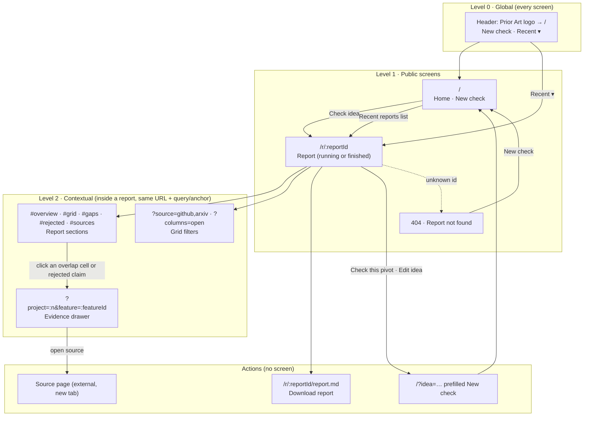

# Prior Art — UX Architecture & Route Map

Phase 09 · Prompt 09.1 · Status: **proposed, awaiting approval** (sitemap and navigation model)

## 0. What this is based on

**Earlier phases.** `docs/` holds no PRD or architecture document from earlier phases, only
`docs/DEMO_SCRIPT.md`. So there is nothing binding to build on beyond the code and the project
context. This document is derived from the code as it stands, cited by file and line below.

**Today's app is one page with no routes.**
- `src/priorart/server.py:20` serves a single HTML page at `/`. Everything else is JSON or streaming:
  - `/api/status` (`:25`)
  - `/api/runs` (`:32`)
  - `/api/runs/{name}` (`:56`)
  - `/api/report/{name}` (`:61`)
  - `/api/run` (`:72`)
- `src/priorart/static/index.html` holds all screens as sections of that one page, and none has its own URL:
  - idea input and "Check it" (`:122–124`)
  - two sample-idea chips (`:125–126`)
  - a failure-demo menu (`:127`)
  - a "Past runs…" dropdown (`:132`)
  - progress (`:136–139`)
  - results (`:142–184`)
  - an evidence drawer (`:189–191`)
- A finished result can't be linked to, refreshed, or shared. The only way back to it is the "Past runs" dropdown (`index.html:214`).

**What a result contains.** These are the nouns users will see (`src/priorart/pipeline.py:376–398`):
- status
- idea
- features, up to 7, ids `F1…F7` (`:102–105`)
- projects, ranked, with citation number `n` (`:340–341`)
- sources
- coverage
- gaps
- novelty
- checks
- verdict
- pivots

**No accounts exist.** There is no sign-in, user model, or per-user storage anywhere in the repo.
`/api/runs` lists the 30 most recent results on the server for every visitor (`server.py:38`).

**Target users: everyone.** The audience is builders, founders and hackathon teams, often first-time
visitors arriving from a shared link.

## 1. The object model users perceive

One label per noun, used everywhere: UI, URLs, docs, the Markdown report.

| Noun (label) | What it is | Internal name today | Notes |
|---|---|---|---|
| **Idea** | The text the user submits | `idea` | Always "idea", never "question", "prompt" or "query" in the UI |
| **Check** | The act of running Prior Art on an idea | `run` | Verb on the button: **Check idea**. Never "run", "search" or "analyze". |
| **Report** | The result of one check, with its own URL | `result`, run JSON | Replaces "run", "past run" and "result" in the UI |
| **Feature** | One of the 4–7 parts the idea is broken into | `features`, `F1…` | Column headers of the grid |
| **Existing project** | A product, repo, paper or hackathon entry that overlaps | `projects`, `P1…` | Short form "project". Never "match", "candidate" or "competitor". |
| **Overlap** | One project × feature cell: **Done**, **Partly** or **Open** | `cells`, score 2/1/0 | Three values, three labels, three colors; no other wording |
| **Evidence** | The quote from the project's page behind an overlap | `quote` | Always shown with its source |
| **Source [n]** | A numbered link to a project's page | `sources`, `n` | Numbering is fixed once a report is saved |
| **Rejected claim** | An overlap the checks threw out, with its reason | `cut_quote`, `cut_verifier` | Two reasons only: **Quote not on the page** and **Quote doesn't prove it**. Replaces "cut" / "claims the checks threw out". |
| **Gap** | A feature no existing project covers | `gaps` | The column header says **Open** |
| **Pivot** | A suggested variation of the idea aimed at the gaps | `pivots` | Can be checked as a new idea |
| **Novelty score** | 0–100, computed from checked overlaps only | `novelty` | When there's no evidence it says **No score**, never 0 |
| **Report status** | ok · low evidence · not enough evidence · failed | `status` (`pipeline.py:378`) | User labels: **Complete**, **Low evidence**, **Not enough evidence**, **Check failed** |

## 2. Sitemap

There are no authenticated routes in this proposal: v1 has no accounts (see Decision A in §8).
Reports are reachable by anyone who has their link.

## 3. Screens

Each screen has one primary action. The required role is "anyone" throughout, because v1 has no roles.

| Screen | Route | Purpose (one sentence) | Primary action | Data shown | Required role |
|---|---|---|---|---|---|
| **Home · New check** | `/` (`/?idea=…` prefills) | Get an idea into a check with as little friction as possible. | **Check idea** | Idea box; two sample ideas; **Recent reports** on this device (title, novelty, date); one line on how checks work, with an expandable explainer | Anyone |
| **Report** (running) | `/r/{reportId}` while status is `running` | Show that real work is happening and what has been found so far. | **Wait / watch.** Secondary: **Cancel**. | Stage chips (Features → Search → Screen → Read pages → Compare → Check claims → Open space, as today at `index.html:197`); live log; features as soon as they exist | Anyone with the link |
| **Report** (finished) | `/r/{reportId}` | Answer "does this exist, and where's the open space?" with every overlap provable. | **Open evidence** (click any overlap) | Status banner; novelty score; verdict with [n] citations; overlap grid; gaps and pivots; rejected claims; numbered sources; models used and time taken | Anyone with the link |
| **Evidence drawer** | `/r/{reportId}?project={n}&feature={featureId}` | Prove or disprove one overlap in one glance. | **Open source** (new tab) | Feature; project and kind; overlap value; quote; check result and reason; source [n] link; page-read note when only a snippet was available | Anyone with the link |
| **Report not found** | any unknown `/r/{id}` | Recover from a dead or mistyped link. | **New check** | One sentence and the Recent reports list | Anyone |

### Screens merged or cut (no primary action of their own)

| Today (code reference) | Decision | Why |
|---|---|---|
| Separate progress card (`index.html:136–139`) | **Merge** into Report (running state) | Progress isn't a destination. Giving the run its URL at the start makes refresh and sharing work mid-check. |
| "Past runs…" dropdown (`index.html:132`), `/api/runs` listing every visitor's runs (`server.py:32–45`) | **Merge** into Home → **Recent reports** and the header's **Recent ▾**, scoped to this browser | Its only action is "open a report". A global list also shows one visitor's ideas to every other visitor once the app is public. |
| A standalone "History" screen (considered) | **Cut** | Same single action as Recent reports, with one more click |
| A standalone "How it works" / About page (considered) | **Cut**. Becomes an expandable explainer on Home and a "How checks work" popover on the Report's check counts. | Read-only content whose only next step is "check an idea" |
| Evidence as its own page (considered) | **Cut**. It's a drawer with a deep link. | Readers compare cells side by side, so leaving the grid breaks that |
| "Claims the checks threw out" card (`index.html:176–178`) | **Keep as a section** (`#rejected`), renamed **Rejected claims** | It's the trust proof. It's part of the Report, not a separate destination. |
| Markdown download (`index.html:183`, `server.py:61`) | **Action**, not a screen: `/r/{id}/report.md` | Nothing to look at in the app |
| Failure-demo menu (`index.html:127`) | **Remove from the public UI.** Keep as `/?simulate=search_down`, honored only when the server enables demo mode. | It's for the hackathon demo, and confusing to everyone else |
| Status pill (`index.html:118`) | **Keep only in demo/offline mode** ("Demo data") | Real users don't need model names in the header; the Report footer lists them |

## 4. Navigation model

**Global, on every screen**
- **Prior Art** logo → `/`
- **New check** button → `/`. On a Report it pre-fills nothing; a fresh start is the expected meaning.
- **Recent ▾**: the last 10 reports opened or created in this browser (title, novelty or status, relative date). The menu is empty until the first check.

**Reachable in one step from anywhere:** Home, New check, any recent report.

**Contextual, inside a Report only**
- **Section anchors**, shown as a sticky sub-nav on long reports: Overview · Grid · Gaps & pivots · Rejected claims · Sources.
- **Grid filters**: by source type (GitHub, Hacker News, Product Hunt, arXiv, Devpost, Web; labels from `src/priorart/search.py:11–16`), and **Open features only**.
- **Report actions**: **Copy link** · **Download report** · **Edit idea** (→ `/?idea=<this idea>`).
- **Per pivot**: **Check this pivot** (→ `/?idea=<pivot>`). The user still presses Check idea, so no credits are spent by accident.
- **Evidence drawer**:
  - **Open source** opens the page in a new tab.
  - **Previous / Next overlap**: arrow keys move along the row.
  - **Esc / ✕** closes it and removes `project` and `feature` from the URL.
  - Every click on a cell or a rejected claim, and every [n] citation, opens the drawer or the source.

**Back button behavior**
- Opening and closing the drawer updates the URL with `replaceState`, so Back leaves the Report rather than replaying drawer opens.
- Changing a filter uses `replaceState`.
- Checking an idea uses `pushState` to `/r/{id}`.

## 5. URL scheme

| URL | Meaning | Rules |
|---|---|---|
| `/` | New check | |
| `/?idea=<url-encoded text>` | New check, prefilled | Never starts a check by itself (a check costs credits). Text is capped at 4,000 characters, matching `server.py:73`. |
| `/r/{reportId}` | A report, running or finished | `reportId` is a random 10-character base-62 id (e.g. `r/7Kq2xP9aLm`). It is fixed when the check starts and never derived from the idea. |
| `/r/{reportId}#overview` · `#grid` · `#gaps` · `#rejected` · `#sources` | A report section | Plain anchors, shareable |
| `/r/{reportId}?project={n}&feature={featureId}` | Evidence for one overlap | `n` = the source number shown in the grid. `featureId` = `F1…F7`. Both are frozen once the report is saved (`pipeline.py:340–341`, `:105`), so the link always opens the same cell. |
| `/r/{reportId}?source=github,arxiv` | Grid limited to those source types | Values are the keys in `search.py:11–16`, comma-separated, any order |
| `/r/{reportId}?columns=open` | Grid limited to gap features | |
| `/r/{reportId}/report.md` | Download the Markdown report | Same content as `src/priorart/report.py` |
| `/?simulate=search_down` · `extract_down` | Failure demo | Ignored unless the server runs in demo mode |

Query parameters combine, e.g. `/r/7Kq2xP9aLm?source=github&project=2&feature=F3#grid`.

**Why random ids instead of today's file names.** Saved runs are named
`<timestamp>-<slug of the idea summary>` (`pipeline.py:407`, `_slug` at `:79`). That leaks the idea
in every shared URL and server log, and the names are guessable. Reports should be unlisted:
private until someone shares the link.

The backing API the routes need is listed under Follow-ups. It's a build-phase change, not part of
this document.

## 6. Key user flows

1. **First check.** Home → type or paste an idea (or tap a sample) → **Check idea** → `/r/{id}` (running) → the same URL turns into the finished Report → click a red cell → the drawer → **Open source**.
2. **Share.** Report → **Copy link** → a teammate opens `/r/{id}` cold, sees the same report, and lands in the right place via `#gaps` or `?project=…&feature=…`.
3. **Iterate on the open space.** Report → Gaps & pivots → **Check this pivot** → Home prefilled → **Check idea** → a new Report. The old one stays in **Recent ▾**.
4. **Doubt a claim.** Report → **Rejected claims** or a check count → the drawer explains the reason → **Open source** to confirm.
5. **Failure.** A check ends in **Check failed** or **Not enough evidence**:
   - the Report shows the banner and **No score**;
   - stages after the failure are struck through;
   - primary action: **Try again** (re-runs the same idea) or **Edit idea**.
6. **Dead link.** `/r/unknown` → Report not found → **New check** or Recent reports.

## 7. Label changes from today's UI

| Today | Becomes |
|---|---|
| "Check it" (`index.html:124`) | **Check idea** |
| "Past runs…" (`:132`) | **Recent ▾** / **Recent reports** |
| "Existing project" column, "Closest projects" in the README example | **Existing project** everywhere |
| "Done / Partly / (blank)" cells, "OPEN" header, "Best coverage" row | **Done / Partly / Open** in cells, the header and the bottom row |
| "cut", "Claims the checks threw out" | **Rejected claim(s)**, reasons **Quote not on the page** / **Quote doesn't prove it** |
| "Where the open space is" | **Gaps & pivots** |
| "Run failed.", "Low evidence.", "Insufficient evidence." | **Check failed**, **Low evidence**, **Not enough evidence** |
| "Download report (.md)" | **Download report** |

## 8. Decisions needed from you

- **A. No accounts in v1** (recommended). Reports are unlisted by link, and "Recent" lives in the browser. That fits "everyone" as the audience: nothing to sign up for. Accounts would add a sign-in screen, synced report history, and per-user limits on credit spend. Listed under Follow-ups, not designed here.
- **B. Timing.** The hackathon deadline is **Nov 20, 8:59 PM PT** (`SUBMISSION_CHECKLIST.md`). Building these routes means changing `server.py` and splitting `index.html`, the code the demo depends on. Recommendation: submit on today's single page and build this after the deadline. The other option is to build only `/r/{id}` deep links before the deadline, since shareable reports help the "opened citations" part of the demo.

**Please approve the sitemap (§2) and navigation model (§4), and decisions A and B, before any screens are built.**

## Follow-ups (out of scope for this phase)

- **API for these routes** (build phase):
  - `POST /api/reports` → `{id}`, starting the check
  - `GET /api/reports/{id}`
  - `GET /api/reports/{id}/events` (stream)
  - `GET /r/{id}/report.md`
  - These replace `GET /api/run?idea=…` (`server.py:72`), which starts paid work from a GET request and puts the idea text in the URL.
- **Stop listing every visitor's runs** at `/api/runs` (`server.py:32–45`) before any public deployment.
- **Cancel a running check**: the pipeline has no cancellation yet (`pipeline.py:264`).
- **Update the docs** if §3 and §7 are approved: `README.md:104`, `docs/DEMO_SCRIPT.md:8,17,18` mention "Past runs", "Failure demo" and "Prior Art itself".
- **Accounts** (if Decision A is reversed later): sign-in, synced report history, per-user usage limits.
- **Earlier phase documents** (PRD, architecture) don't exist in `docs/`. If they live elsewhere, add them so later phases can treat them as binding.
